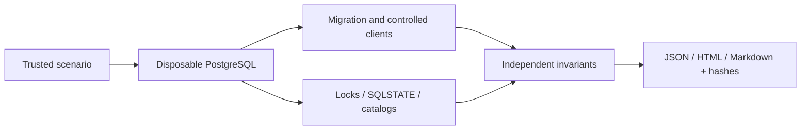

# MigrationWitness

[中文说明](README_ZH.md) · [Actual pg-osc case](PG_OSC_197_RESULTS.md) · [Acceptance results](CROSS_VERSION_RESULTS.md) · [Architecture](docs/ARCHITECTURE.md)

[](https://github.com/KaiserIIII/migrationwitness/actions/workflows/ci.yml)

Run a PostgreSQL migration against a disposable database while checking application contracts, lock waits and recovery state. MigrationWitness is an experimental test harness, not a migration engine or a production database monitor.

It creates its own private local cluster, seeds synthetic business rows, runs controlled clients, observes PostgreSQL and evaluates declared invariants independently of migration exit codes. JSON, HTML and Markdown reports link checks to raw SQL and catalog events. Nothing connects to an existing database.

## A completed migration can still break client access

Untouched **pg-osc 0.9.10** completed a real integer-to-bigint shadow-table swap with exit code 0, while the application role lost SELECT/INSERT/UPDATE. Independent connections returned **SQLSTATE 42501** (`permission denied for table business`). Owner and all 100 synthetic rows remained intact.

| Fixed PostgreSQL version | Real pg-osc migrations | Grant-loss results | Fresh native ALTER controls |
| --- | --- | --- | --- |
|16.15 |3 |3/3 lost the three explicit grants |3/3 retained grants |
|17.11 |3 |3/3 lost the three explicit grants |3/3 retained grants |

These six migrations and six native controls reproduce known [pg-osc#197](https://github.com/shayonj/pg-osc/issues/197) under the recorded versions and explicit-grant configuration. The 100-row fixtures had no concurrent business writes during pg-osc; they do not establish behavior for every PostgreSQL/pg-osc version, arbitrary ACLs or production loads. A later caller GRANT restored access in these cases; it is not an upstream fix.

Read the [actual experiment](PG_OSC_197_RESULTS.md), [reproducible Ruby environment](env/PG_OSC_REPRODUCTION.md), [executed probe](scripts/pgosc_197_probe.py) and [derived twelve-run evidence summary](examples/pgosc-197-summary.json). Original private raw logs are not distributed.

## How it works



The [architecture](docs/ARCHITECTURE.md) explains cluster ownership, acknowledged-operation ledgers, observation barriers and outcome classification.

## Supported scope

- PostgreSQL 16 and 17 on Linux, including a dedicated WSL environment on Windows.
- Python 3.12+ is the declared minimum; actual fresh-install acceptance used Linux Python 3.14.8 and Windows Python 3.13.0. Other interpreters have not been accepted. See [CROSS_VERSION_RESULTS.md](CROSS_VERSION_RESULTS.md).
- Windows can install the Python package, list scenarios and verify/render offline evidence. Native Windows PostgreSQL cluster execution is deliberately refused; use WSL/Linux. Native Windows PostgreSQL acceptance is **NOT RUN**.
- Twelve native control scenarios, editable trusted SQL/JSON cases, opt-in external argv, independent committed-data/role/constraint checks, SQLSTATE and lock evidence.

## Install

Use a normal, unprivileged Linux user with official PostgreSQL server binaries (`initdb`, `pg_ctl`, `postgres`) installed. Do not run PostgreSQL as root.

```sh
git clone https://github.com/KaiserIIII/migrationwitness.git
cd migrationwitness
python3 -m venv .venv
. .venv/bin/activate
python -m pip install .
python -m migrationwitness list
python -m migrationwitness run concurrent_dml --pg-bin /usr/lib/postgresql/17/bin --output runs/dml-001
python -m migrationwitness verify runs/dml-001
```

On Alpine the binary path is `/usr/libexec/postgresql17`. On Debian/Ubuntu it is commonly `/usr/lib/postgresql/17/bin`; point to the actual installed version. Every output directory must be new.

Windows PowerShell (offline operations):

```powershell
git clone https://github.com/KaiserIIII/migrationwitness.git
cd migrationwitness
py -3.13 -m venv .venv
.\.venv\Scripts\python.exe -m pip install .
.\.venv\Scripts\python.exe -m migrationwitness list
.\.venv\Scripts\python.exe -m migrationwitness verify C:\path\to\copied-run
```

Python dependencies are pinned in `pyproject.toml`; acceptance artifacts and source commits are listed in [DEPENDENCIES.md](docs/DEPENDENCIES.md). Installation needs package-index access; an audit manifest accompanies the local delivery, not vendored executables.

## Reproduce a controlled failure

```sh
python -m migrationwitness run privileges_bad --pg-bin /usr/lib/postgresql/17/bin --output runs/acl-bad
python -m migrationwitness run privileges_safe --pg-bin /usr/lib/postgresql/17/bin --output runs/acl-safe
python -m migrationwitness run index_cancel --pg-bin /usr/lib/postgresql/17/bin --output runs/index-interrupted
python -m migrationwitness run examples/add-column.json --pg-bin /usr/lib/postgresql/17/bin --output runs/custom
```

`privileges_bad` intentionally recreates a table without restoring SELECT for an existing role: migration SQL succeeds, but the old reader gets SQLSTATE 42501. `index_cancel` waits until PostgreSQL reports the concurrent-index lock barrier, cancels that connection and records the invalid index before cleanup. These demonstrate expected native behaviors. They are not newly discovered PostgreSQL bugs.

CLI exit codes: **0** contract PASS; **2** contract FAIL/INCONCLUSIVE or evidence verification failure; **1** invalid input, environment or framework ERROR. Broken controls intentionally return 2. `control_agreement` records whether an intentionally broken/fixed fixture behaved as expected; it is not a correctness verdict for a real migration.

## Caller cases and API

`examples/add-column.json`, `examples/broken-backfill.json` and `examples/trusted-psql.json` are editable input cases. `pgosc-197-summary.json` is evidence summary, not scenario input. SQL is trusted executable input. The built-in fixture is `public.business(id integer PRIMARY KEY, value text NOT NULL)` with 100 deterministic rows. A custom case may supply `setup_sql`, exactly one of `migration_sql` or `migration_argv`, optional `concurrent_workload`, and boolean SQL `assertions`. Assertions must return exactly one result set containing one boolean cell; multiple result sets and other ambiguous results are INCONCLUSIVE, with all result sets retained. Leaving a transaction open fails the commit boundary; final business rows and assertions use separate connections. Setup SQL must not alter the fixture's initial business rows unless a changed-data failure is intended.

```python
from pathlib import Path
from migrationwitness.runner import run
result = run('index_recover', Path('/usr/lib/postgresql/17/bin'), Path('runs/recovered'))
assert result['outcome'] == 'PASS'
```

For an external migration command, provide a literal argv list in a reviewed JSON case and explicitly pass `--allow-trusted-command`. Its environment points to the newly created cluster through PostgreSQL environment variables. Commands must honor those variables. No shell expansion is performed. A trusted command can still ignore that connection and access other resources: review it and run inside an isolated lab. This is not an OS sandbox.

`examples/trusted-psql.json` is an actual tested additive migration via official `psql` under concurrent writes. Run it with the same `run` command and `--allow-trusted-command`. Python subprocesses are explicitly set to UTF8; raw stdout/stderr bytes are additionally retained as base64. Non-UTF8 output is marked instead of silently treated as an exact UTF8 transcript.

## Evidence and limitations

**Research decision: NO-GO for a new scientific contribution.** This is a source experimental engineering tool; no new migration algorithm or paper-level innovation is claimed.

- Reports retain SQL text, synthetic raw values, outcomes, SQLSTATE, transaction status, query elapsed time, `pg_locks`, `pg_stat_activity`, blocker PIDs and before/after definitions/ACLs. Caller scripts could expose private data or secrets: never supply them.
- SHA-256 manifests detect changed or missing files relative to a supplied manifest. They are not signatures and do not prove who generated evidence. Keep the manifest/hash through a trusted channel.
- Bounded selected controls do not establish production false-positive/false-negative rates, arbitrary schedule coverage, or migration safety under all workloads. Sampling can miss short waits. Backfill controls exercise an explicit deterministic interleaving, not all possible concurrent executions.
- Trusted custom SQL can change timeouts, allocate large results or create descendants. There is no hard CPU/memory/disk quota or security isolation. Built-in workloads have fixed budgets; arbitrary trusted scripts do not have a hard whole-run deadline. POSIX ordinary process groups are cleaned up; detached descendants and Windows descendants are not contained.
- A final-state check does not prove full transactional isolation, linearizability, replication/failover correctness or preservation of all object metadata.
- The original environments of reported upstream issues are not fully specified. Exact status and actual reproductions are distinguished in [UPSTREAM_VALIDATION.md](docs/UPSTREAM_VALIDATION.md).
- Existing tools already implement schema validation, hazards, privilege diffs, recovery and client-version mechanisms. The value here is an engine-independent runtime witness bundle; no new algorithm, scientific innovation or superiority claim. See [COMPETITORS.md](docs/COMPETITORS.md).

## Tests

```sh
python -m pip install pytest==9.0.3
MW_PG_BIN=/usr/lib/postgresql/17/bin python -m pytest -q
```

Without `MW_PG_BIN`, real-database tests are skipped and must be reported NOT RUN. [EXPERIMENT_PROTOCOL.md](docs/EXPERIMENT_PROTOCOL.md) defines selected controls before execution. [ARCHITECTURE.md](docs/ARCHITECTURE.md), [SECURITY.md](docs/SECURITY.md), [FINAL_REPORT.md](FINAL_REPORT.md) and [RESUME.md](RESUME.md) describe the delivery and evidence locations.

[Actual hosted acceptance](https://github.com/KaiserIIII/migrationwitness/actions/runs/39122362491) for the accepted source candidate `472b98d` passed all three jobs:

| Hosted environment | Full suite | Additional checks |
| --- | --- | --- |
|Linux container / Python 3.14.8 / PostgreSQL16.15 |40 passed,1 root-only skip |root refusal, installed CLI/run/verify |
|Linux container / Python 3.14.8 / PostgreSQL17.11 |40 passed,1 root-only skip |root refusal, installed CLI/run/verify |
|Windows / Python 3.13.0 / offline |21 passed,20 explicit skips |installed CLI, Unicode, escaped report, tamper rejection |

Linux CI uses a container limited to 2 CPUs, 1 GiB RAM and 256 PIDs, a 512 MiB tmpfs and bounded test/job deadlines; these are external CI limits, not product isolation. Windows skips 19 PostgreSQL-dependent tests and 1 POSIX process-group test. Native Windows PostgreSQL is unsupported/NOT RUN. CI does not rerun the legacy pg-osc experiment or establish production correctness. The separate local Docker-daemon path remains NOT RUN; hosted Docker execution passed. [Acceptance details](CROSS_VERSION_RESULTS.md) distinguish current CI from the original local runs and [preparation record](docs/CI_PREPARATION.md).

MIT licensed. Third-party tools and PostgreSQL are not bundled; their own licenses apply.
