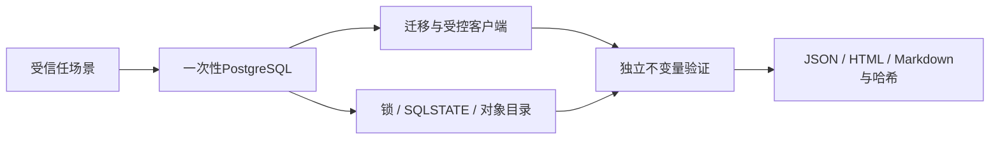

# MigrationWitness

[English](README.md) · [真实 pg-osc 实验](PG_OSC_197_RESULTS.md) · [跨版本验收](CROSS_VERSION_RESULTS.md) · [架构图](docs/ARCHITECTURE.md)

MigrationWitness 在一次性 PostgreSQL 数据库中执行受信任的迁移，检查业务数据、旧客户端、权限、锁等待和中断恢复是否满足明确约束。它是本地源码实验版，不是迁移引擎或生产数据库管理工具。

工具会创建私有测试实例，写入受控数据，通过独立连接执行并发操作和正确性检查，保留 SQLSTATE、事务状态、锁、活动会话及对象目录证据，生成 JSON、HTML、Markdown 报告。它不接受已有生产数据库的连接地址。外部命令仍属受信任代码，可能忽略连接环境；必须在隔离实验环境中使用。

## 真实验收

- PostgreSQL16.15、17.11：从干净检出目录和全新虚拟环境安装后，各40项通过、1项仅适用于root的测试跳过；root拒绝检查另行通过。
- Windows/Python3.13.0：21项通过、20项跳过，涵盖离线CLI、Unicode、报告及篡改拒绝。**未运行原生Windows PostgreSQL**，数据库实验请用Linux或WSL。
- 真正的pg-osc0.9.10列类型迁移在两个PG版本各运行3次：影子表切换完成、命令退出0，但业务用户原有SELECT/INSERT/UPDATE均丢失并返回42501。数据与OWNER保持；原生ALTER的6次对照保留权限。随后显式恢复GRANT可恢复这3种操作。
- [GitHub托管验收](https://github.com/KaiserIIII/migrationwitness/actions/runs/39122362491)已实际通过：Linux容器中的PG16/17各40项通过、1项root分支跳过，root拒绝测试另行通过；Windows离线21项通过、20项明确跳过。两类平台均执行了实际支持的CLI检查。托管CI未重复运行旧Ruby的pg-osc实验，也不证明生产迁移正确。独立本地Docker守护进程路径仍为NOT RUN，托管Docker执行已通过。

这是固定pg-osc0.9.10、PG16.15/17.11和显式GRANT配置下的已知问题复现，迁移时没有并发业务写入；不能推广到所有PG/pg-osc版本、任意ACL或生产负载。**科研结论维持NO-GO**，不声称首次发现、新迁移算法或论文创新。默认校验确实能拦住pg-schema-diff#316；报告保留这一保护结果，不夸大本工具差异。

## 工作流程



CI容器限制为2CPU、1GiB内存、256PID和512MiB临时文件系统，另有测试及任务时限；它们不等于产品提供硬资源隔离。Windows跳过的20项为19项数据库相关测试和1项POSIX进程组测试。

## 安装与运行

在装有官方PostgreSQL二进制的Linux普通用户下执行，不能以root初始化数据库：

```sh
git clone https://github.com/KaiserIIII/migrationwitness.git
cd migrationwitness
python3 -m venv .venv
. .venv/bin/activate
python -m pip install .
python -m migrationwitness list
python -m migrationwitness run concurrent_dml --pg-bin /usr/lib/postgresql/17/bin --output runs/dml-001
python -m migrationwitness verify runs/dml-001
```

Alpine路径通常为`/usr/libexec/postgresql17`；每次输出目录必须是新的。精确验收依赖及SHA位于两个平台lock文件，适用Python/平台不同，不要混用。完整说明见[英文README](README.md)和[交接文档](HANDOFF.md)。

Windows离线操作：

```powershell
git clone https://github.com/KaiserIIII/migrationwitness.git
cd migrationwitness
py -3.13 -m venv .venv
.\.venv\Scripts\python.exe -m pip install .
.\.venv\Scripts\python.exe -m migrationwitness list
.\.venv\Scripts\python.exe -m migrationwitness verify C:\path\to\copied-run
```

主CLI退出码：0=约束PASS，2=FAIL/INCONCLUSIVE或证据校验失败，1=输入/环境/框架错误。故意损坏的控制场景应返回2；不能把“按预期检出了故障”说成迁移正确。可编辑JSON见examples，断言必须只有一个结果集中的一个布尔单元格，多结果集返回INCONCLUSIVE。

可选真实pg-osc复现使用[scripts/pgosc_197_probe.py](scripts/pgosc_197_probe.py)和[固定Ruby环境说明](env/PG_OSC_REPRODUCTION.md)。该调查脚本退出0表示调查完成，正确性必须看报告中的outcome；它不采用主CLI的0/2/1语义。

## 使用边界

没有产品内置的硬内存、CPU、磁盘配额或任意脚本总时限；SQL可改超时，受信任命令可访问当前用户资源，脱离进程组的子进程不受完整隔离。CI容器的资源限制不等于产品提供硬隔离。

生产环境误报/漏报率、所有调度、复杂权限/元数据、复制故障转移、其他版本均未证明。哈希只能相对于可信清单发现文件变化，不是数字签名。原始报告可能含调用者SQL、值、主机名和路径，分享前需审查。本次公开清单只含源码、文档和明确派生的真实合成数据实验摘要，不含私有原始日志、虚拟环境或第三方二进制。

项目MIT许可，第三方依赖保留各自许可证。已作为[源码实验版](https://github.com/KaiserIIII/migrationwitness)公开；未创建正式Release、发布PyPI包或部署公网服务。发布后冻结功能开发。
