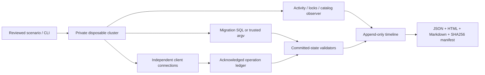

# Architecture

`cluster.py` owns a new mode0700 tempfile, initializes a new cluster and database `mw_test`, and binds a private Unix socket with no TCP listener. It does not accept DSNs. It retains ownership information until stopping the owned server. A startup attempt is treated as potentially successful even when subsequent evidence I/O fails. Failed stop retains the directory rather than deleting live data.

`runtime.py` captures SQL results/errors and transaction states. It advances through all SQL result sets, retaining rows/columns/status and result_set_count; first-result rows remain compatible. Custom boolean assertions require exactly one result set with one boolean cell, otherwise INCONCLUSIVE. Workload writers use disjoint keys, each statement commits before the independent intended-operation ledger acknowledges it. The final oracle reads from a different connection. This bounded row model is not a general serializability checker.

`scenarios.py` implements the predeclared controls. Catalog-visible conditions and reader events establish required interleavings. Lock snapshots are taken while the wait exists. Backfill uses an explicitly controlled stale-copy schedule; no random coverage claim. `custom.py` accepts small reviewed cases and flags an unfinished migration transaction before independent assertions. Arbitrary SQL remains trusted.

`commands.py` invokes argv with no shell. Captures are bounded and timeout/nonzero/truncation/incomplete capture are visible. POSIX ordinary process groups are killed on timeout and surviving groups are cleaned after parent exit. This does not contain detached sessions or provide a Windows Job/cgroup.

`evidence.py` writes new files, ordered events (`seq`, monotonic `timeline_s`), SHA256 inventory and escaped offline reports. Command `elapsed_s` and SQL `elapsed_query_s` are separate duration fields. Checks reference event sequence numbers. File hashes are integrity checks relative to a trusted manifest, not authenticity claims. Offline verification needs no database.

Outcome taxonomy: PASS = all declared checks true; FAIL = one false; INCONCLUSIVE = unresolved/empty checks without false; ERROR = environment or framework prevented evaluation. A command exit is evidence about execution only. `control_agreement` compares the outcome to the known deliberately broken/fixed fixture; it does not turn a FAIL into database PASS.
